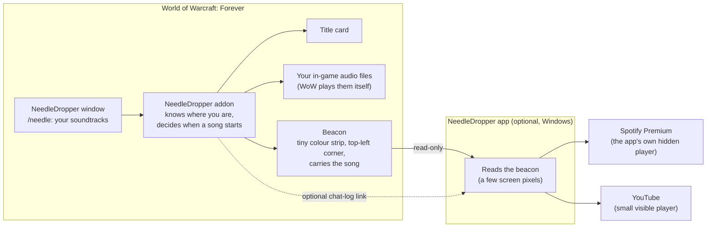

# NeedleDropper

**Kojima-style needle drops for World of Warcraft: Forever.**

The first time your character crests a hill into Elwynn Forest, the zone music fades away, a song
begins, and a quiet title card drifts in at the top of the screen:

```
                    E L W Y N N   F O R E S T
                    ─────────────────────────
                    The Beatles  ·  Here Comes the Sun
```

One hand-picked song, for one place, once. Then the world goes quiet again until you find somewhere
new.

NeedleDropper is an **addon** that knows where you are, decides when a song should start, and lets
you choose every song in game: type `/needle`, stand somewhere, press **Add drop here** and paste a
Spotify or YouTube link. An optional **app** for Windows (`NeedleDropper.exe`) plays the songs through
**Spotify Premium** (in its own hidden player: no Spotify window) or **YouTube**; songs from **your own
audio files** play inside WoW itself. It is free, open source and [MIT licensed](LICENSE).

---

## The idea

In *Death Stranding*, Hideo Kojima keeps his licensed songs for a few rare moments. You have walked
for a long time, the landscape opens up in front of you, and a melancholy, spacious song starts while
the title card fades in. The music doesn't decorate the journey; it marks an arrival. Players call
that a **needle drop**.

NeedleDropper brings that moment to Azeroth:

- **Silence is the default.** A song plays only when you arrive somewhere for the first time.
- **Drops are rare.** A cooldown (10 minutes by default) keeps them special.
- **Each place plays once** per character (or once per account, if you prefer).
- **It waits for a calm moment.** Not in combat, not on a flight path, not while dead or watching a
  cinematic.
- **It respects your history.** Characters who already explored a zone don't get its song dumped on
  them at login.

## How it works



1. **You curate in game.** The NeedleDropper window shows which song plays where. Change one, add a
   place, or switch soundtracks: it takes effect at once, without a `/reload`.
2. The **addon** notices you have arrived somewhere new (the game's "Discovered: …" message, or a
   short stay in a zone you have never explored) and waits for a calm moment.
3. When the moment comes, it fades out the zone music, shows the **title card**, and either plays
   your own audio file in WoW or writes the song to the **beacon**: a strip of coloured squares, at
   most 336 × 9 pixels, in the top-left corner of the game window.
4. The **app** reads that strip from the screen a few times per second. It never touches the game
   itself: no memory reading, no injection, no simulated key presses. It plays the song on Spotify,
   in a player of its own that never shows a window, or on YouTube in a small box that shows only
   while the song plays, and fades it out when the song ends or when you get into a long fight. The
   app holds no soundtrack of its own: everything it needs to know arrives in the beacon.

## Features

- **First-arrival songs** for zones, capitals, landmarks and (optionally) dungeons and raids.
- **One window, in game** (`/needle`, the add-on compartment or a key binding) with three tabs:
  **Drops**, **Soundtracks** and **Journal**. Settings live in the game's Settings panel.
- **Add drop here**: stand anywhere, press one button, type the artist and title (paste a Spotify or
  YouTube link too, for the exact recording), **Test**. Done.
- **Two built-in soundtracks:**
  - **Azeroth Mixtape** (the default): 38 iconic places, half the songs fitting, half funny
    ([liner notes](docs/MIXTAPE.md));
  - **Azeroth Unbound** (optional): the quiet, Kojima-style score for every zone, with Low Roar as its
    anchor ([liner notes](docs/SOUNDTRACK.md)).
- **Make them yours:** **Change song here** or **Turn off here** on any built-in drop. Your changes go
  into **My Drops**, a personal layer on top, and **Revert** brings the original back.
- **Your own soundtracks**, stacked in the order you choose, with a different list per character if
  you like.
- **Share codes:** a whole soundtrack as one piece of text (`!NeedleDropper:1!…!`) to paste into
  Discord; friends import it with a preview ([how](docs/PACKS.md#share-codes)).
- **A cinematic title card**: centred, letter-spaced, in your game language, gone again after a few
  seconds. Hidden with the rest of the UI when you press Alt+Z.
- **Smart timing**: arrival delay, faster drops on discovery, a global cooldown, and pauses for combat,
  flight paths, death, cinematics and boss encounters.
- **A journal** of every song you have heard, with replay and "play again next visit".
- **Three ways to play**: Spotify Premium and YouTube through the app, your own audio files in WoW.
- **Music services in game**: *Options → AddOns → NeedleDropper* shows the app's status, sets up
  Spotify (your Client ID goes into the **Music services** dialog, `/needle music`), picks *Play music
  with* (Spotify first, YouTube first, only one of them, or neither) and the YouTube box's corner, and
  has **Test Spotify** and **Test YouTube** buttons.
- **A tiny app**: a one-time Connect page, then just a tray icon that starts with Windows and stays
  quiet. Spotify songs play inside it (Google Chrome needed), so no Spotify window ever comes up.
- **Private and read-only**: nothing leaves your PC except what Spotify and YouTube need to play the
  music, and an optional daily update check that is off unless you set it up
  ([privacy](docs/PRIVACY.md), [policies](docs/POLICY.md)).

## Quick start

1. **Install the addon** with your addon manager (search for *NeedleDropper*), or unzip
   `NeedleDropper-<version>-addon.zip` into `World of Warcraft\_forever_\Interface\AddOns`
   ([how](docs/INSTALL.md#1-install-the-addon)).
2. **Optional, for Spotify and YouTube: install the app.** Unzip `NeedleDropper-<version>-win64.zip`
   somewhere permanent and double-click **`NeedleDropper.exe`**. If Windows says *"Windows protected
   your PC"*, click **More info → Run anyway** ([why](docs/INSTALL.md#windows-protected-your-pc)).
   On its **Connect** page, sign in to **Spotify** (Premium and Google Chrome) or simply use
   **YouTube**, which needs no setup ([music services](docs/PROVIDERS.md)); you can also set up
   Spotify later in game (`/needle music`). Start the app before the game the first time (or restart
   the game once): the game finds the app's small data addon only when it starts. Then, in the game,
   type `/needle test`: the page ticks **Check the link**.
3. **Play.** Go somewhere your character has never been. The zone music fades, the title card drifts
   in, and with the app running the song starts. (Without the app you see the title card only; those
   places play their song once the app is installed.)
4. **Type `/needle`** to open the window: see what plays where, press **Add drop here**, type the artist
   and title (or paste a link as well), **Test** it ([soundtracks](docs/PACKS.md)).
5. **Share.** On the Soundtracks tab, **Share...** gives you a code to paste into Discord; friends paste
   it into **Import...** ([share codes](docs/PACKS.md#share-codes)).

Full walk-through: [docs/INSTALL.md](docs/INSTALL.md).

## In game

| Command | What it does |
|---|---|
| `/needle` (or `/nd`) | Open or close the NeedleDropper window |
| `/needle add [Artist - Title \| link]` | Add a drop where you stand, with its song if you give one |
| `/needle soundtracks` | Open the Soundtracks tab |
| `/needle journal` | Open the Journal tab: the songs you have heard, with replay |
| `/needle import` | Paste a share code |
| `/needle music` | Open **Music services**: Spotify and YouTube, *Play music with*, the test songs |
| `/needle status` | What is pending or playing, why a drop is waiting, the cooldown, the link to the app |
| `/needle report` | A text report of your setup to paste into a bug report |
| `/needle stop` | Stop the song that is playing; nothing else starts here until you move on |
| `/needle help` | Every command |

The add-on compartment (the small numbered button by the minimap) opens the window with a left-click
and the settings with a right-click; hovering over it shows what is playing. The complete list of
commands and settings is in the [command reference](docs/TROUBLESHOOTING.md#needle-command-reference).

## Documentation

| Guide | Read it for |
|---|---|
| [Install](docs/INSTALL.md) | Installing the addon and the app, the Connect page, updating from 1.2.0 or 1.1, uninstalling |
| [Soundtracks](docs/PACKS.md) | The window, adding and changing drops, your own soundtracks, share codes, the pack format |
| [Music services](docs/PROVIDERS.md) | Connecting Spotify Premium (it plays inside the app), using YouTube, *Play music with*, playing your own audio files in game |
| [Troubleshooting](docs/TROUBLESHOOTING.md) | When the link or a song doesn't work, every `/needle` command and option |
| [Privacy](docs/PRIVACY.md) | What NeedleDropper stores, and what (little) leaves your PC |
| [Policies](docs/POLICY.md) | Blizzard's add-on policy, the Spotify and YouTube rules, and how NeedleDropper follows them |
| [Azeroth Mixtape](docs/MIXTAPE.md) · [Azeroth Unbound](docs/SOUNDTRACK.md) | The liner notes of the built-in soundtracks |
| [Changelog](CHANGELOG.md) | What changed in each version |

## Building from source

For developers: the addon is plain Lua 5.1; the companion app is a Python 3.10+ package that uses only
the standard library.

```
cd companion
python -m needledropper            # start the app (tray icon; the Connect page on first run)
python -m needledropper --help     # every command (diag, packs, ...)
```

Run the tests with `python -m pytest tests -q` from the repository root. The built-in soundtracks are
generated from `packs/*.json` with `python tools/gen_sets.py` (see [docs/SETS-FORMAT.md](docs/SETS-FORMAT.md)).
Build a release (tests, the soundtrack check, `NeedleDropper.exe`, the addon zip, the two Windows
zips and `SHA256SUMS.txt`, all in `dist\`) with:

```
.venv\Scripts\python.exe -m pip install -r companion\build-requirements.txt
powershell -ExecutionPolicy Bypass -File tools\build_release.ps1
```

Before a release, run the in-game check in [docs/FIRST-TEST.md](docs/FIRST-TEST.md) on a real client.

The addon zip for CurseForge, Wago and WoWInterface can also be built by the
[BigWigs packager](https://github.com/BigWigsMods/packager) from [`.pkgmeta`](.pkgmeta).

## Credits and inspiration

- **Hideo Kojima and Kojima Productions' *Death Stranding***, whose needle drops (Low Roar, Silent
  Poets and others) are the whole idea.
- **The *Soundtrack* addon** for World of Warcraft, for the "silent track" trick that fades out zone
  music without touching your sound settings.
- **The artists of the built-in soundtracks.** NeedleDropper ships no music; it only plays songs you
  can already stream or own. If a drop moves you, follow, stream or buy the artist.

NeedleDropper is a fan project. It is not affiliated with or endorsed by Blizzard Entertainment,
Kojima Productions, Sony Interactive Entertainment, Spotify or Google/YouTube. World of Warcraft is a
trademark of Blizzard Entertainment; Death Stranding is a trademark of Sony Interactive Entertainment;
Spotify and YouTube are trademarks of their owners.

## License

[MIT](LICENSE) - Copyright (c) 2026 NeedleDropper contributors. The license covers NeedleDropper's
code and documentation. Songs are not included; soundtracks only name them.
